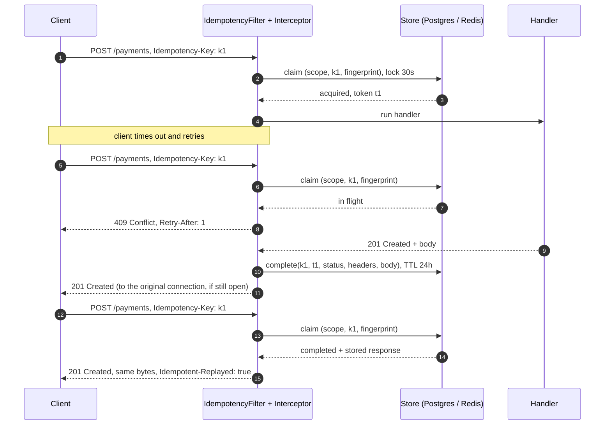

# idempotency-spring-boot-starter

Stripe-style `Idempotency-Key` support for Spring MVC APIs, with PostgreSQL, Redis and in-memory stores, plus a small inbox that makes webhook handlers run once per provider event.

Built and tested on Spring Boot 4.1 and Java 21.

## The problem

A client sends `POST /payments`. The server charges the card, then the connection drops before the response arrives. The client can't tell whether the charge happened, so it retries, and the customer is charged twice. Mobile apps on bad networks, load balancer timeouts, SDKs with automatic retries and users double-clicking all cause the same thing.

Stripe's answer, now an [IETF draft](https://datatracker.ietf.org/doc/draft-ietf-httpapi-idempotency-key-header/), is the `Idempotency-Key` header. The client generates a unique key per operation and sends it with every retry. The server runs the operation once and replays the stored result to every retry. From [Stripe's API docs](https://docs.stripe.com/api/idempotent_requests): "if a connection error occurs, you can safely repeat the request without risk of creating a second object or performing the update twice", and "the idempotency layer compares incoming parameters to those of the original request and errors if they're not the same to prevent accidental misuse."

Brandur Leach's [Implementing Stripe-like Idempotency Keys in Postgres](https://brandur.org/idempotency-keys) explains why this is harder than it looks: two requests with the same key can arrive at the same time, a server can die halfway through and leave the key locked, and work that leaves your database (a card network call, an email) can't be rolled back.

Webhooks have the same problem in the other direction. Payment providers deliver events at least once, so a `payment.settled` event can arrive twice and post two ledger entries.

## What it does

Put `@Idempotent` on a handler:

```java
@Idempotent(key = Idempotent.KeyRequirement.REQUIRED)
@PostMapping("/v1/payments")
ResponseEntity<Payment> create(@RequestBody CreatePayment request) {
    String chargeId = cardNetwork.charge(...);   // must not happen twice
    ...
    return ResponseEntity.created(location).body(payment);
}
```

| Situation | Response | Handler runs? |
|---|---|---|
| First request with a key | Whatever the handler returns. The response is stored. | Yes |
| Retry, same key, same request, first one finished | The stored status, selected headers and exact body bytes, plus `Idempotent-Replayed: true` | No |
| Duplicate while the first is still running | `409 Conflict`, `Retry-After: 1` | No |
| Same key, different request (body, path, method or chosen headers differ) | `422 Unprocessable Content` | No |
| First attempt ended in 5xx, 408 or 429, or the handler threw | Not stored. The key is released, so a retry runs again. | Yes, on retry |
| Key older than the TTL (default 24h) | Treated as new | Yes |
| First attempt crashed and never finished | Lock expires after `lock-timeout` (default 30s), then a retry runs | Yes, after expiry |
| No key, endpoint doesn't require one | Passes through untouched | Yes |
| No key, endpoint requires one | `400 Bad Request` | No |

The 409, 422 and 400 responses are `application/problem+json` ([RFC 9457](https://www.rfc-editor.org/rfc/rfc9457)).

"Same request" means the same method, path and query, any headers listed in `idempotency.fingerprint-headers`, and the same body. JSON bodies are canonicalized first (sorted keys, no whitespace), so `{"a":1,"b":2}` and `{ "b": 2, "a": 1 }` match. Numbers keep their exact text, so `1` and `1.0` don't. Form posts are compared by their sorted parameters.

Keys are scoped per client: by default from a header your gateway sets (`idempotency.scope.header`), else the authenticated principal. Two tenants using the same key never see each other's responses. You can plug in your own `IdempotencyScopeResolver`.



## Install

It isn't published to Maven Central. Two options:

Local install:

```bash
git clone https://github.com/gratycodes/idempotency-spring-boot-starter.git
cd idempotency-spring-boot-starter
mvn install -DskipTests -pl idempotency-spring-boot-starter -am
```

```xml
<dependency>
  <groupId>io.github.gratycodes</groupId>
  <artifactId>idempotency-spring-boot-starter</artifactId>
  <version>0.1.0-SNAPSHOT</version>
</dependency>
```

Or [JitPack](https://jitpack.io), which builds from GitHub using the `jitpack.yml` in this repo (I haven't verified a JitPack build yet):

```xml
<repositories>
  <repository>
    <id>jitpack.io</id>
    <url>https://jitpack.io</url>
  </repository>
</repositories>

<dependency>
  <groupId>com.github.gratycodes.idempotency-spring-boot-starter</groupId>
  <artifactId>idempotency-spring-boot-starter</artifactId>
  <version>main-SNAPSHOT</version>
</dependency>
```

The starter expects Spring MVC on the classpath. It picks a store automatically:

| Your app has | Store used (`idempotency.store=auto`) |
|---|---|
| A `DataSource` (`spring-boot-starter-jdbc`) | JDBC |
| No `DataSource` but a Redis connection factory (`spring-boot-starter-data-redis`) | Redis |
| Neither | In-memory, with a startup warning |

Set `idempotency.store=jdbc|redis|memory` to choose explicitly; a missing backend then fails startup instead of silently falling back. Declare your own `IdempotencyStore` bean to replace all of them.

For JDBC, create the tables from [`schema.sql`](idempotency-spring-boot-starter/src/main/resources/io/github/gratycodes/idempotency/jdbc/schema.sql) with your migration tool, or set `idempotency.jdbc.initialize-schema=true` for development.

## Configuration

| Property | Default | |
|---|---|---|
| `idempotency.enabled` | `true` | Turns everything off. |
| `idempotency.header-name` | `Idempotency-Key` | |
| `idempotency.require-key` | `false` | Global default; `@Idempotent(key = REQUIRED/OPTIONAL)` overrides per endpoint. |
| `idempotency.max-key-length` | `255` | Longer keys get 400. |
| `idempotency.methods` | `POST, PATCH` | |
| `idempotency.include-paths` | empty | Path patterns that are idempotent without the annotation, e.g. `/api/**`. |
| `idempotency.ttl` | `24h` | How long a response is replayed. `@Idempotent(ttl = "1h")` overrides. |
| `idempotency.lock-timeout` | `30s` | Longest a request may hold a key. Must exceed your slowest request. |
| `idempotency.retry-after` | `1s` | `Retry-After` on 409. |
| `idempotency.replay-headers` | `Content-Type, Content-Language, Location` | Response headers stored and replayed. |
| `idempotency.fingerprint-headers` | empty | Request headers that must also match, e.g. `X-Account-Id`. |
| `idempotency.cache-server-errors` | `false` | Stripe stores 5xx responses too; set `true` for that behaviour. |
| `idempotency.never-cache-statuses` | `408, 429` | |
| `idempotency.scope.header` | unset | Header naming the tenant/client. Only use one your gateway sets after auth. |
| `idempotency.scope.use-principal` | `true` | Fall back to the authenticated principal. |
| `idempotency.filter-order` | `0` | Runs after Spring Security (-100) by default. |
| `idempotency.store` | `auto` | `auto`, `jdbc`, `redis`, `memory`. |
| `idempotency.jdbc.table` | `idempotency_keys` | |
| `idempotency.jdbc.initialize-schema` | `false` | |
| `idempotency.redis.key-prefix` | `idempotency:` | |
| `idempotency.webhook.table` | `webhook_inbox` | |

## How the stores work

PostgreSQL (`JdbcIdempotencyStore`), each step one auto-commit statement, so no transaction stays open while your handler runs:

1. `INSERT ... ON CONFLICT DO NOTHING`. One row inserted means this request owns the key.
2. Otherwise a conditional `UPDATE ... WHERE (state = 'IN_FLIGHT' AND locked_until <= now) OR (state = 'COMPLETED' AND expires_at <= now)` takes over a dead lock or an expired key. PostgreSQL re-evaluates the `WHERE` after waiting on the row lock, so two requests can't both take over the same stale lock.
3. Otherwise `SELECT` the row and answer 409, 422 or replay.

Completing and releasing only touch the row if the caller's lock token still matches. A request that was so slow its lock expired and another request took over can't overwrite the newer result; it's counted as `lock_lost`. Expired rows are removed by `store.purgeExpired()`, which you schedule (the sample app runs it every 10 minutes).

Redis (`RedisIdempotencyStore`): one hash per key, and every operation is a single Lua script. Claiming is "create if absent, with a TTL of `lock-timeout`", the hash form of `SET key token NX PX`. Completing checks the token, writes the response and resets the TTL to the replay TTL. Redis expires dead locks and old keys by itself.

In-memory: a `ConcurrentHashMap`, for tests and local runs only.

All three run the same contract test suite, including 48 threads racing for one key and 48 threads racing to take over one stale lock.

## Webhook inbox

```java
@PostMapping("/webhooks/psp")
Map<String, String> receive(@RequestBody PspEvent event) {
    boolean processed = inbox.processOnce("fakepsp", event.id(), () -> {
        jdbc.update("UPDATE payments SET status = 'settled' WHERE id = ?", event.paymentId());
        jdbc.update("INSERT INTO ledger_entries (event_id, payment_id, amount) VALUES (?, ?, ?)", ...);
    });
    return Map.of("result", processed ? "processed" : "duplicate");   // 200 either way
}
```

`processOnce` inserts `(provider, event_id)` with `ON CONFLICT DO NOTHING` and runs the handler in the same transaction. A duplicate inserts nothing and skips the handler. On PostgreSQL a concurrent duplicate waits for the first delivery's transaction and then skips. If the handler throws, the inbox row rolls back with everything else, so the provider's redelivery is processed normally. If your handler already runs in `@Transactional`, call `inbox.markProcessed(provider, eventId)` inside it instead.

Verify the provider's signature before calling the inbox. The sample skips that to stay small.

## Metrics

With Micrometer on the classpath:

- `idempotency.requests{outcome}`: `executed`, `replayed`, `conflict`, `mismatch`, `rejected`, `released`, `lock_lost`
- `idempotency.webhooks{provider, outcome}`: `processed`, `duplicate`

A rising `conflict` count usually means clients retry too aggressively. Any `lock_lost` means `lock-timeout` is shorter than some requests.

## Sample app

[`sample-payments-api`](sample-payments-api) is a tiny payments API on H2 (or PostgreSQL with the `postgres` profile). The card network is a fake that counts charges. All data is synthetic.

```bash
mvn install -DskipTests
mvn -pl sample-payments-api spring-boot:run

KEY=$(uuidgen)
for i in 1 2; do
  curl -si localhost:8080/v1/payments \
    -H "Idempotency-Key: $KEY" -H "X-Api-Client: merchant_demo" -H "Content-Type: application/json" \
    -d '{"amount":4999,"currency":"EUR","customer":"cus_demo_1"}'
done
# The second response is the same 201 with Idempotent-Replayed: true. One charge was made.

curl -s 'localhost:8080/actuator/metrics/idempotency.requests?tag=outcome:replayed'
```

## Tests

```bash
mvn verify
```

- Unit tests: JSON canonicalization, fingerprinting, header storage, the engine's rules.
- Store contract (in-memory, H2, PostgreSQL, Redis): ownership tokens, stale-lock takeover, TTL expiry, byte-exact round trips, concurrent claims.
- HTTP end to end through real Tomcat on every backend: replay, 409, 422, tenant scoping, 5xx not cached, crash releases the key, 24 parallel duplicate requests with exactly one execution.
- Webhook inbox on H2 and PostgreSQL: duplicates, rollback on failure, 16 concurrent deliveries with one ledger row.
- The sample app's own tests.

PostgreSQL and Redis tests use Testcontainers and need Docker. Without Docker they're skipped locally. CI fails if any of them was skipped. To run them against servers you already have, set `IT_POSTGRES_URL`, `IT_POSTGRES_USER`, `IT_POSTGRES_PASSWORD`, `IT_REDIS_HOST` and `IT_REDIS_PORT`.

## Limitations

- **This is not a distributed transaction.** If the handler calls a card network and the server dies before the response is stored, the key's lock expires and a retry runs the handler again. Pass your own idempotency key to downstream APIs that support one (Stripe, Adyen), or record progress in your database the way Brandur's article describes. This starter guarantees that a stored result is replayed and that two attempts never run at the same time. It can't make external side effects exactly-once.
- **The response is stored after the handler commits.** If storing it fails (database down), the client still gets its response, but the key stays locked until `lock-timeout` and a later retry runs again. If the store is down when a request arrives, the request fails with 500 (fail closed). There is no fail-open mode.
- **Validation errors are stored.** A 400 from your handler is replayed on retry, unlike Stripe, which doesn't store responses for requests that fail validation before execution starts. Add 400 to `never-cache-statuses` if you want Stripe's behaviour.
- Spring MVC only. WebFlux, async handlers (`DeferredResult`, `Callable`) and streaming responses aren't supported. An async handler's key stays locked until it expires.
- Responses written with `response.sendError(...)` are released, not stored, because the container renders their body later.
- Request and response bodies are held in memory. Not suited for large uploads.
- The JDBC store uses application clocks. Large clock skew between instances (more than `lock-timeout`) can let a second instance take over a live lock.
- Redis replication is asynchronous, so a failover can lose recent claims. Use PostgreSQL if that matters.
- Tested on Spring Boot 4.1. The auto-configuration also names the Boot 3 classes, but Boot 3 isn't tested.

## Other libraries

I looked at these before writing this one. Several are solid choices.

| Library | What it is | How it differs |
|---|---|---|
| [transferwise/idempotence4j](https://github.com/transferwise/idempotence4j) | Wise's library for idempotent *actions*: you wrap code in `idempotenceService.execute(actionId, ...)`. PostgreSQL and MariaDB, Micrometer, Spring Boot starter. | Works at the service layer, not HTTP, and you map results yourself. More flexible for non-HTTP work; no header handling, response replay or webhook inbox. |
| [lu1tr0n/idempotency-spring-boot-starter](https://github.com/lu1tr0n/idempotency-spring-boot-starter) | HTTP starter for Boot 3 with JDBC and Redis, Stripe-style mismatch detection, 409 on concurrency, a WebFlux filter. On Maven Central. | Very close in scope and further along: WebFlux and a published artifact. This one targets Boot 4 and adds a webhook inbox. |
| [benhendayoussef/idempotency-spring-boot-starter](https://github.com/benhendayoussef/idempotency-spring-boot-starter) | `@Idempotent` with Redis and JDBC stores, user/tenant scopes from Spring Security, configurable release on 5xx and timeouts, WebFlux for `Mono`. On Maven Central. | The most complete of the group, with good documentation of its edge cases. Similar model to this one. |
| [arthurfaby/spring-boot-starter-idempotency](https://github.com/arthurfaby/spring-boot-starter-idempotency) | Interceptor plus filter following the IETF draft. On Maven Central. | Same filter/interceptor split as this one. |
| [strongbad/spring-idempotency-kit](https://github.com/strongbad/spring-idempotency-kit) | AOP `@Idempotent` on any Spring bean, Redis only, wait-or-reject on concurrency, fail-open or fail-closed. | Works on any method, not just HTTP. Has fail-open; this one only fails closed. |

If you need WebFlux or a Maven Central artifact today, use one of the above. This project's focus is a small, readable implementation where every backend runs the same concurrency tests, plus webhook dedupe in the same library.

## Project layout

```
idempotency-spring-boot-starter/   the library: core, stores, web layer, webhook inbox, auto-configuration
sample-payments-api/               a payments API using it end to end
```

## License

MIT, see [LICENSE](LICENSE).
